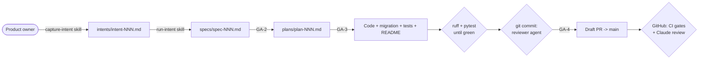

# expense-flow-api

An asynchronous corporate **expense submission and approval** API, built as a reference
implementation of Anthropic's
[AI-Native SDLC Playbook](https://claude.com/resources/articles/the-ai-native-sdlc-playbook).

The application is deliberately small. The point is the **engineering system around it**:
every change goes through versioned artifacts (intent -> spec -> plan -> code). Each change
is routed through a **Gated** (human-in-the-loop) or **Autonomous** workflow according to
its risk, and is verified by deterministic CI gates and an independent adversarial reviewer
agent.

| | |
|---|---|
| Language | Python 3.13, fully type-annotated |
| Toolchain | [`uv`](https://docs.astral.sh/uv/) (no pip/poetry), `ruff` (strict lint + format) |
| API | FastAPI with async dependency injection |
| Persistence | SQLAlchemy 2.0 (async) + SQLite (`aiosqlite`), Alembic migrations |
| Money | `decimal.Decimal` end to end, stored as integer cents. No floats, ever. |

---

## Quick start

```bash
brew install uv                       # or: curl -LsSf https://astral.sh/uv/install.sh | sh
uv sync                               # installs Python 3.13 and all dependencies
uv run alembic upgrade head           # creates ./expense_flow.db from the migrations
uv run uvicorn expense_flow.main:app --reload
```

Open the interactive API docs at http://127.0.0.1:8000/docs.

```bash
curl -X POST http://127.0.0.1:8000/claims -H 'content-type: application/json' \
  -d '{"employee_id": "emp-042", "category": "MEALS", "amount": "64.50",
       "description": "Client lunch", "receipt_url": "https://receipts.example.com/r/981"}'
```

Configuration comes from environment variables (or a `.env` file):

| Variable | Default | Purpose |
|---|---|---|
| `DATABASE_URL` | `sqlite+aiosqlite:///./expense_flow.db` | Async SQLAlchemy URL |
| `ENVIRONMENT` | `development` | `development`, `test` or `production` |
| `SQL_ECHO` | `false` | Log SQL statements |

The app never creates tables itself. **Run `uv run alembic upgrade head` before starting it**,
in every environment.

---

## API endpoints

| Method | Path | Description | Success | Errors |
|---|---|---|---|---|
| `GET` | `/health` | Liveness probe | 200 | |
| `POST` | `/claims` | Submit a claim (policy checked) | 201 | 422 (validation or policy) |
| `GET` | `/claims/{claim_id}` | Get one claim | 200 | 404 |
| `POST` | `/claims/{claim_id}/approve` | Approve a `SUBMITTED` claim | 200 | 404, 409, 422 (policy) |
| `POST` | `/claims/{claim_id}/reject` | Reject a `SUBMITTED` claim with a reason | 200 | 404, 409, 422 |

**Amounts are JSON strings** with at most 2 decimal places (`"49.99"`), both in requests
and responses. Policy failures return every broken rule at once:

```json
{
  "detail": "Expense policy violation",
  "violations": [{"code": "RECEIPT_REQUIRED", "message": "Meal claims over EUR 50.00 require a receipt_url"}]
}
```

A claim is decided once: approving or rejecting a claim that is no longer `SUBMITTED`
returns **409**.

## Expense policy rules

Defined as pure functions in [`src/expense_flow/policy.py`](src/expense_flow/policy.py).
All thresholds are `Decimal` and **exclusive** (exactly EUR 50.00 needs no receipt).

| Code | When checked | Rule |
|---|---|---|
| `RECEIPT_REQUIRED` | Submission | `MEALS` claims with amount **> EUR 50.00** must include a `receipt_url` |
| `AMOUNT_EXCEEDS_MAXIMUM` | Submission | A single claim cannot exceed **EUR 2,500.00** |
| `VP_APPROVAL_REQUIRED` | Approval | Claims with amount **> EUR 500.00** can only be approved by a `VP` |

## Data model

`expense_claims` ([`models.py`](src/expense_flow/models.py)):

| Field | Type | Notes |
|---|---|---|
| `id` | int | Primary key |
| `employee_id` | str(64) | Indexed |
| `category` | enum | `MEALS`, `TRAVEL`, `LODGING`, `EQUIPMENT`, `OTHER` |
| `amount` | Decimal | `Money` type: stored as integer cents |
| `currency` | str(3) | Always `EUR` |
| `description` | str(500) | |
| `receipt_url` | str(2048), nullable | |
| `status` | enum | `SUBMITTED` -> `APPROVED` or `REJECTED`. Indexed. |
| `submitted_at` | datetime | UTC |
| `decided_at` | datetime, nullable | UTC |
| `approver_id` | str(64), nullable | |
| `approver_role` | enum, nullable | `MANAGER`, `VP` |
| `rejection_reason` | str(500), nullable | |

---

## Testing

```bash
uv run ruff check .          # strict lint
uv run ruff format --check . # formatting
uv run pytest                # all tiers
uv run pytest -m eval        # one tier: unit | integration | eval
```

| Tier | Location | What it proves |
|---|---|---|
| Unit | `tests/unit/` | Policy boundaries to the cent, schema validation, the `Money` type |
| Integration | `tests/integration/` | Full HTTP lifecycle against a real database. **Migrations:** upgrade -> downgrade -> upgrade, plus `alembic check` (models and migrations never drift) |
| Evals | `tests/evals/` | Financial invariants: exact round-trips, 10,000 x EUR 0.01 = EUR 100.00 in Python and SQL, JSON strings not floats, no `float` anywhere in `src/` |
| Hooks | `tests/hooks/` | The pre-commit review hook fires on every `git commit` and fails closed |

---

## The AI-native SDLC



`GA-n` are **human approvals, in gated mode only**. In autonomous mode Claude records
`approved_by: claude (autonomous)` and continues.

| Piece | File | Role |
|---|---|---|
| Rules | [`CLAUDE.md`](CLAUDE.md) | Mandatory rules for agents and humans: uv, Decimal, migrations, self-testing, doc sync |
| Review checklist | [`REVIEW.md`](REVIEW.md) | What every review checks: spec compliance, money, migrations, tests, docs. Used by both reviews below. |
| Capture an intent | [`.claude/skills/ai-native-sdlc-demo-capture-intent/`](.claude/skills/ai-native-sdlc-demo-capture-intent/SKILL.md) | Turns a PO request into an intent; picks Gated or Autonomous (`[LLM]` => autonomous) |
| Deliver an intent | [`.claude/skills/ai-native-sdlc-demo-run-intent/`](.claude/skills/ai-native-sdlc-demo-run-intent/SKILL.md) | Spec -> plan -> code -> draft PR, pausing for approval at each gate in gated mode |
| Reviewer agent | [`.claude/agents/reviewer.md`](.claude/agents/reviewer.md) | Read-only adversarial reviewer: `VERDICT: APPROVE` or `VERDICT: REQUEST_CHANGES` |
| Pre-commit review | [`scripts/review_gate.py`](scripts/review_gate.py) + [`.claude/settings.json`](.claude/settings.json) | Hook: the reviewer agent runs before **every** `git commit` Claude makes and blocks it on `REQUEST_CHANGES` |
| CI | [`.github/workflows/ci.yml`](.github/workflows/ci.yml) | Deterministic gates on every PR: ruff, Alembic, pytest |
| PR review | [`.github/workflows/claude-review.yml`](.github/workflows/claude-review.yml) | Claude reviews every PR in GitHub against `REVIEW.md`: inline comments + a verdict |
| `@claude` | [`.github/workflows/claude.yml`](.github/workflows/claude.yml) | Mention `@claude` on a PR or issue: Claude fixes the code on the PR branch and pushes |
| Code owners | [`.github/CODEOWNERS`](.github/CODEOWNERS) | Changes to the SDLC machinery itself need a human code owner |

**Branches:** one `feature/<NNN>-<slug>` branch per intent, merged into `main` through a pull request.
**Status fields:** intents go `captured` -> `implemented` -> `merged`; specs and plans go `draft` -> `approved`.

### Two reviews: before every commit, and on every PR

| When | Who reviews | If it finds problems |
|---|---|---|
| Claude runs `git commit` in this repo | The **reviewer agent**, through the pre-commit hook | The commit is blocked and the findings go back to Claude, which fixes them and commits again. If the review can't run, the commit is blocked too. |
| A PR is opened or updated | **Claude in GitHub** (`claude-review.yml`) | Inline comments marked *Important* / *Nit*, and a summary with a verdict. Comment `@claude fix the Important findings`: Claude pushes a fix, and the review runs again. |

Both apply the same checklist, [`REVIEW.md`](REVIEW.md). Neither review approves a PR: a
human code owner does. (CODEOWNERS makes any change to `REVIEW.md` itself need that owner.)

Notes: commits that only touch Markdown in `intents/`, `specs/` or `plans/` skip the
pre-commit review (the gates cover them). Commits you make yourself in a terminal skip
it too; GitHub reviews them on the PR. A pre-commit review takes 1 to 3 minutes and uses
your Claude account.

---

## Running the demos

### Prerequisites

1. `uv sync && uv run alembic upgrade head`
2. [Claude Code](https://code.claude.com/docs) installed and logged in (`claude --version`).
3. `brew install gh && gh auth login`, with `main` pushed to GitHub (for the PR step).
4. Start from an up-to-date `main`: `git switch main && git pull`.
5. Open this repository in **Claude Code**: the CLI (`claude` from the repo root) or the
   **Code** tab of Claude Desktop with this folder selected. Both skills are project-scoped:
   they live in this repository and load only here.

### Track 1: the Gated migration flow

*A policy change that needs a schema change: high risk, so a human approves each stage.*

1. **Capture the intent (GA-1).** Say to Claude, as the product owner:
   > Finance wants every claim over EUR 100 to carry a cost center so spend can be
   > allocated to budgets. Make `cost_center` mandatory for claims over EUR 100.

   The skill asks Gated or Autonomous (pick **Gated**), clarifies the threshold
   (`> 100.00`?), writes `intents/intent-002-....md` and stops.
2. **Start delivery:** `/ai-native-sdlc-demo-run-intent intents/intent-002-....md`.
   Claude creates `feature/002-...` and writes `specs/spec-002-....md`.
3. **GA-2, the spec.** This is the key moment of the demo: check the migration strategy.
   Is `cost_center` nullable? What happens to existing rows? Ask for changes, or approve.
4. **GA-3, the plan.** Claude writes `plans/plan-002-....md`. Review, then approve.
5. **Implementation.** Claude edits `models.py`, autogenerates the Alembic migration, adds
   tests and updates this README, then runs ruff + pytest until green. On `git commit`,
   the **reviewer agent** reviews the change and can block the commit.
6. **GA-4, the PR.** Claude shows the diff and the review verdict. Approve, and it opens a
   **draft PR to `main`**. Claude reviews it in GitHub a minute later.

### Track 2: the Autonomous feature flow

*A well-scoped, additive ticket that is pre-approved for automation.*

1. Paste the ticket into Claude:
   > [LLM] Add a new expense category SOFTWARE. SOFTWARE claims over EUR 100 must include a
   > `reviewer_note` when they are approved.

2. The `[LLM]` tag makes the capture skill stamp `workflow_mode: autonomous` and
   `ticket_tag: LLM`, then hand over to the run-intent skill.
3. Claude runs hands-off: spec and plan (auto-approved), implementation, tests until
   green, a commit reviewed by the reviewer agent, then a **draft PR to `main`**.
4. Claude stops and asks you only if it is blocked: gates still red after 3 attempts,
   the reviewer blocks twice, an ambiguous requirement, or a change to the SDLC machinery.
5. On the PR, comment `@claude <request>` for follow-up changes.

---

## GitHub setup

Both Claude workflows (`claude-review.yml` and `claude.yml`) run on your **Claude
subscription** (Pro works), so no separately billed API key is needed. Their usage counts
toward your plan's limits. One-time setup:

1. **Install the Claude GitHub App** on this repository: https://github.com/apps/claude
2. **Create a subscription token**: run `claude setup-token` in a terminal and copy the token.
3. **Add it as a secret** named `CLAUDE_CODE_OAUTH_TOKEN` (repository Settings -> Secrets and
   variables -> Actions), or run `gh secret set CLAUDE_CODE_OAUTH_TOKEN` and paste it.
4. **Protect `main`** (Settings -> Branches): require a pull request, require the
   `Deterministic verification` check, and turn on **Require review from Code Owners**,
   so changes to the SDLC machinery need a human. On a free GitHub account, branch
   protection is only enforced on public repositories.

Docs: https://code.claude.com/docs/en/github-actions. (Team and Enterprise plans can use
the managed [Claude Code Review](https://code.claude.com/docs/en/code-review) instead of
`claude-review.yml`; it reads the same `REVIEW.md`.)
